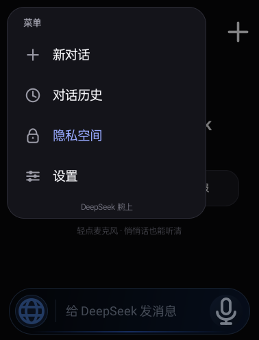
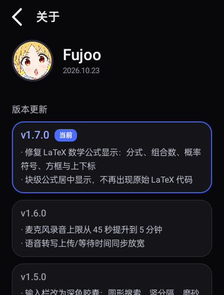
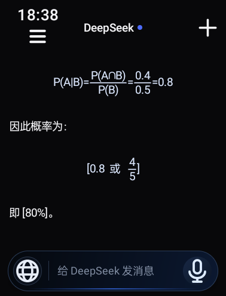
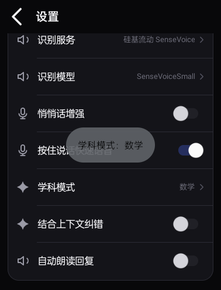
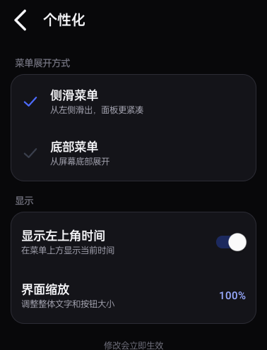

# DeepSeek 腕上

为 **32 位 Android 智能手表** 做的 DeepSeek 客户端：极简深色 UI、流式对话、深度思考、联网搜索、历史记录、隐私空间，以及为手表麦克风优化的语音输入。

已在 **OPPO OWW221（Android 11，armeabi-v7a，378×496）** 真机验证。


## 功能

- 流式聊天、深度思考、Markdown 渲染
- LaTeX 数学公式：分式与斜杠分数画成上下结构，组合数、概率符号、方框、上下标，块级公式居中
- 特别版学科模式：自动 / 数学 / 语文 / 地理 / 其他；数学口语自动转符号，按学科热词纠错
- 联网搜索，回答带引用与来源列表
- 四位密码隐私空间，普通/隐私历史隔离
- 按住输入框说话，松手自动发送；上滑取消
- 5 分钟长录音，SenseVoice / TeleSpeechASR / 自定义 ASR
- 首次启动界面缩放适配（50%–130%），适配不同分辨率手表
- 首次启动使用教程，可从设置再次打开
- 个性化：侧滑 / 底部菜单、左上角时间开关、界面缩放
- 手机网页辅助配置 API Key
- 本地 SQLite 历史；无统计、无广告

## 截图

| 菜单 | 关于 |
| --- | --- |
|  |  |






## 目录

```text
watchchat/            源码、资源、构建脚本
  java/               Java 源码
  res/                图标与图片资源
  AndroidManifest.xml
  build.sh            无 Gradle 的构建脚本
out/                  APK
docs/                 README 截图
```

## 构建

项目不使用 Gradle，依赖本地 Android 工具链：

- `android-28/android.jar`
- `aapt2`
- `d8` / `r8.jar`
- `zipalign`
- `apksigner`
- 一个 debug keystore

默认脚本期望工具链位于仓库上一级的 `build/toolchain`：

```bash
bash watchchat/build.sh
```

产物：`watchchat/build/DeepSeekWear-v1.8.0-special.apk`

如果没有该目录，请按 `watchchat/build.sh` 顶部的变量准备工具链，或修改路径。

## 安装

```bash
adb install -r out/DeepSeekWear-v1.8.0-special.apk
```

## 配置

API Key 不写入源码。首次打开后在设置中填写：

- DeepSeek API Key
- SiliconFlow / 其它 OpenAI 兼容 ASR Key（可选）
- 识别模型、接口地址

也可以使用“用手机配置”，在手机浏览器里填写。

## 说明

- 这是非官方客户端，与 DeepSeek / SiliconFlow 无隶属关系。
- 聊天记录与密钥只保存在手表本地。
- 语音识别依赖第三方 ASR 服务，效果受麦克风、噪声和模型影响。
- 更多细节见 [watchchat/README.md](watchchat/README.md)。
